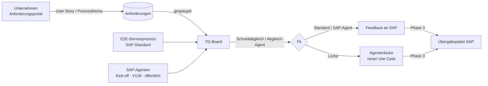

# Plattform-Konzept

## Ziel
Die Themengruppe braucht einen gemeinsamen Ort, an dem sie (1) den Serviceprozess im SAP-Standard und die geplanten
SAP-Agenten **gemeinsam sieht**, (2) **Lücken** erkennt, (3) **Anforderungen der Unternehmen** sammelt, abgleicht und
priorisiert und (4) Ergebnisse **an SAP übergibt** – entlang der TG-Phasen aus dem Kick-off.

## Datenmodell
- **Prozess** (`processes/E2E-SERVICE.json`): Lanes nach SAP-Rollen (Service Agent, Service Sales, Service Planner, Dispatcher,
  Shipping/Receiving, Technician, Finance), Schritte mit Bereich von Autonomous Service (01 Case Management … 06 Confirm & Close),
  Systemen, Objekten, Apps, Scope Items, Quellen, Kundennachrichten und Marker.
- **SAP-Agenten** (`sap-agents.json`): Bereich, Produkt, Status, Verfügbarkeit, Fähigkeiten, Rollen, Verortung (`nodeIds`),
  frühere Namen (Kick-off), Suchbegriffe, Quellen; dazu Joule-Assistenten.
- **Agentenlücken** (`gaps.json`): Schritte, Beschreibung, vorgeschlagener Agent, Nutzen, verknüpfte Anforderungen, Status.
- **Anforderungen**: Inhalt gehört der einreichenden Person (Art, Bezug, Kategorie, Titel, Anmerkung, User Story mit
  Akzeptanzkriterien, Schritte, Agenten, Priorität, Nutzen); **Bewertung** gehört der Moderation (Status, Abgleich, TG-Priorität,
  SAP-Rückmeldung, Lücke, Historie); Kommentare und Unterstützung gehören ihren Verfasser:innen.

## Speicher und Rechte
Das Modell wird in Dokumente je Eigentümer aufgeteilt (`src/core/model-io.ts`):

| Dokument | Inhalt | Schreiben (Artifact-Regel) | Schreiben (Seite/Server) |
|---|---|---|---|
| `board/<datei>` | Prozess, Agenten, Lücken, Quellen, Seed-Anforderungen | `admin` (Bearbeiter/in) | Moderation |
| `review/<ANF-ID>` | Status, Abgleich, Priorität | `admin` | Moderation |
| `portal/<Nutzer-ID>` | Profil, eigene Anforderungen, Kommentare, Unterstützung | `{self}` – nur die Person | die Person |
| `config/access` | Moderation, Board-Zugang | `owner` | Eigentümer |

Im Artifact schützt der Speicher die persönlichen Dokumente technisch; Board-Sichtbarkeit und Moderationsrolle prüft die Seite
(gegen `config/access`). Wer Bereiche strikt trennen will, betreibt den Plattform-Server mit Zugangscodes.

## Agenten
| Agent | Bereich | Werkzeuge | Ergebnis |
|---|---|---|---|
| Prozess-Agent | Board, Portal | Prozess, Schritt, Agenten, Abdeckung, Anforderungen, Suche; Moderation: `propose_changes` | Antwort; ggf. Change-Set (Lücke, Verortung) |
| User-Story-Assistent | Portal | Prozess, Agenten, Suche, Schnellabgleich, `propose_draft` | Entwurf fürs Formular |
| Abgleich-Agent | Board | Anforderung, Schritt, Agenten, Abdeckung, ähnliche Anforderungen, `propose_assessment` | Abgleich-Vorschlag (Moderation bestätigt) |

Alle Agenten schlagen nur vor; übernommen wird mit den Rechten der Person. Im Artifact laufen sie über das Claude-Konto der
Person (`sample`), auf dem Server über die Claude API (Tool Runner, adaptives Denken).

## Abdeckung („Wo fehlen Agenten?“)
Je Aktivität: **verfügbar** (mind. ein verfügbarer Agent), **geplant** (nur geplant/Lab/WIP), **Lücke** (kein Agent, aber Bedarf
oder dokumentierte Lücke), **ohne Agent**. Zusätzlich zeigt das Board dokumentierte Lücken auch dort, wo zwar SAP-Agenten
verortet sind, sie den Bedarf aber nicht decken – das ist der eigentliche Beitrag der Themengruppe.
